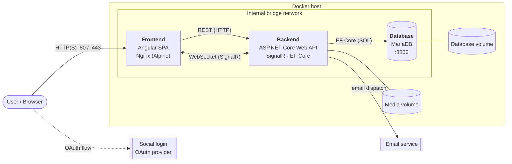

# SSD Project

A containerized, three-tier web application built with **Angular**, **ASP.NET Core** and **MariaDB**, orchestrated with **Docker Compose**.

## Repositories

| Repository | Layer | Stack |
|---|---|---|
| [`ssd-frontend`](https://github.com/sudo3141/ssd-frontend) | Client | Angular (TypeScript), served by Nginx |
| [`ssd-backend`](https://github.com/sudo3141/ssd-backend) | Application | .NET / ASP.NET Core Web API, SignalR, EF Core |
| [`ssd-database`](https://github.com/sudo3141/ssd-database) | Data | MariaDB |
| [`.github`](https://github.com/sudo3141/.github) | — | Organization profile and shared documentation |

## Infrastructure & Architecture Overview

The application uses a modern, containerized three-tier microservices architecture, orchestrated via Docker Compose. This keeps environments consistent across development and production, and keeps the presentation, business logic and data storage layers strictly isolated.

The infrastructure is distributed across three Docker containers that communicate over an internal bridge network:

### 1. Client Layer — Frontend container

- **Technology:** Angular (TypeScript), served by a lightweight Nginx web server on an Alpine Linux base image.
- **Role:** The user-facing Single Page Application (SPA). It handles client-side routing, the Social Login OAuth flow, and provides a responsive UI.
- **Network behavior:** Exposes ports `80` / `443` to the host machine. It makes asynchronous HTTP requests and opens WebSocket connections to the backend container for real-time updates.

### 2. Application Layer — Backend container

- **Technology:** .NET (ASP.NET Core Web API) running on a Microsoft-optimized Linux container image.
- **Role:** The central hub of the application. It validates authentication tokens, processes business logic, and handles email dispatch events.
- **Key integrations:**
  - **SignalR** keeps persistent WebSocket connections with the Angular frontend for real-time data synchronization.
  - **Entity Framework Core (EF Core)** is the ORM, executing secure, parameterized queries against the database.
- **Storage:** Mounts a dedicated Docker volume for persistent local storage of uploaded media (images, audio, video), kept on the host independently of the container's lifecycle.

### 3. Data Layer — Database container

- **Technology:** MariaDB (relational database).
- **Role:** Secure, transactional and persistent storage for all core application entities (users, relationships, logs).
- **Configuration & security:** Fully isolated from the outside network. Port `3306` is exposed only on the internal Docker bridge network, so only the backend container can reach it. A separate Docker volume ensures database records persist across container restarts and teardowns.

### Summary

| Container | Image base | Exposed to host | Talks to | Persistent volume |
|---|---|---|---|---|
| Frontend | `nginx:alpine` | `80`, `443` | Backend (HTTP, WebSocket) | — |
| Backend | Microsoft .NET (Linux) | — | Database (`3306`), email service | Uploaded media |
| Database | `mariadb` | — (internal only) | — | Database data |
